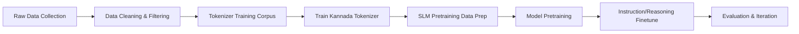
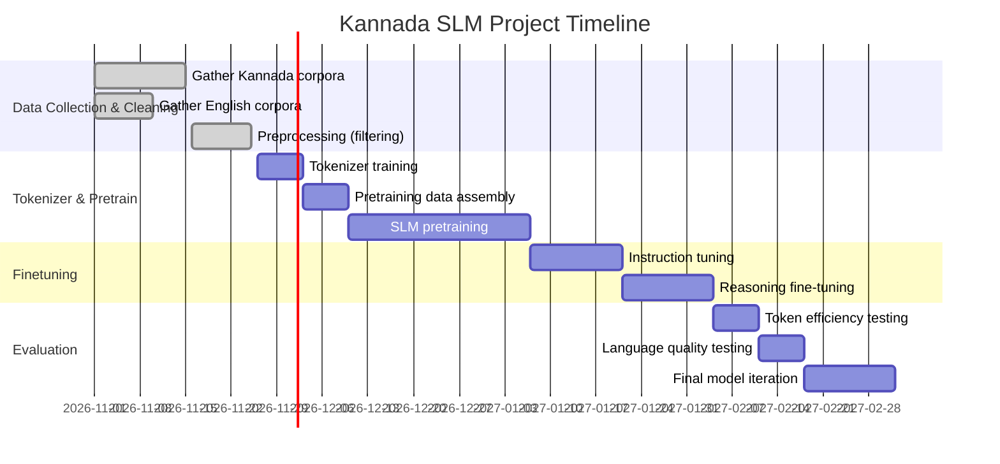

# Kannada-First Token-Efficient SLM: Final Dataset Collection & Training Plan

**Executive Summary:** We propose a **Kannada-centered Small Language Model** (SLM) that optimizes Kannada tokenization and reasoning while retaining English as a secondary language. The goal is to reduce the “token tax” on Kannada text, which occurs when multilingual models use inefficient tokenization and internal English proxies for non-English queries. Our plan encompasses six dataset categories: (1) Kannada pretraining corpus, (2) English supplementary corpus, (3) Kannada instruction-following data, (4) Kannada reasoning (math/aptitude/logic) data, (5) Kannada knowledge/psychology data, and (6) speech data (ASR/TTS). We prioritize **open, high-quality sources** (AI4Bharat, Hugging Face, Common Crawl, OpenSLR, Wikimedia). Each dataset is annotated with **source links** (often Hugging Face IDs) and **usage notes**. We outline thorough preprocessing (language detection, Unicode normalization, deduplication, boilerplate removal, quality filters) and provide sample cleaning code. We design a **ChatGPT-based distillation pipeline** to generate verified Kannada reasoning examples (with teacher prompt templates and automated answer-checks). We also detail the **tokenizer training plan** (corpus composition, experiments with BPE/SentencePiece/Unigram, vocab sizes 8K/16K/24K/32K) and evaluation metrics (token-fertility, token reduction formula, perplexity, reasoning accuracy, inference cost). Sample training mixtures, JSON formats, and code snippets are included. Diagrams illustrate the data pipeline and project timeline. The result is a **print-ready plan (PDF style)** with clear headings, bullet lists, tables, clickable links, and mermaid diagrams, ready for implementation.

## 1. Problem & Objectives

**Token Tax in Kannada:** Large LLMs (e.g. GPT, Claude) are trained on mostly English text. When processing Kannada, their tokenizers break Kannada words into many small sub-tokens, inflating token counts. This leads to high inference cost and reduced context usage for Kannada. Moreover, these models often “think” in English internally (translating inputs to English, reasoning, then back to Kannada), further wasting tokens. 

**SLM Solution:** Build a **Kannada-first SLM** with an optimized Kannada tokenizer. Objectives:

- **Token Efficiency:** Reduce tokens-per-word for Kannada vs. existing tokenizers.  
- **Kannada-Native Reasoning:** Ensure the model can reason directly in Kannada (math, logic, general QA) without English intermediates.  
- **Instruction Following:** Support Kannada instructions and dialogues (like Qwen/GPT style).  
- **English Support (Secondary):** Retain English understanding for technical terms, code, and mixed queries, but as a minor focus.

**Key Metrics:** Our research metrics will include *token fertility* (tokens per Kannada word), *token reduction* vs. baselines, answer accuracy, reasoning accuracy, inference latency, and cost. 

## 2. Dataset Categories

We organize data into **six collections** (to be preprocessed and mixed as needed):

1. **Kannada Pretraining Corpus (monolingual text):** Kannada web text, books, Wikipedia, educational content – to teach the model language modeling in Kannada.
2. **English Supplementary Corpus:** Quality English text (web, education, code) – to provide knowledge and preserve English ability at a low proportion.
3. **Kannada Instruction Data:** Question-answer pairs, dialogues, prompts/responses in Kannada – to train instruction-following behavior.
4. **Kannada Reasoning Data:** Mathematics, aptitude, logic, science, and everyday reasoning problems (Kannada-language) with step-by-step solutions.
5. **Kannada Knowledge & Psychology Data:** General knowledge (history, science, geography), plus psychology and social science topics – to broaden factual knowledge and thematic content.
6. **Speech Data (ASR & TTS):** Kannada speech corpora for ASR training, and speech synthesis corpora for TTS (Kannada text paired with audio).

Each category uses prioritized sources, listed below with links and notes.

## 3. Kannada Pretraining Corpus

*(Primary: very high volume)*

Collect large-scale Kannada text for model pretraining and tokenizer training. Priorities:

- **Sangraha (AI4Bharat IndicLLMSuite)** – Multilingual Indic corpus from crawling books, web, OCR. Supports Kannada. (License: CC-BY-4.0) . Hugging Face: [ai4bharat/sangraha](https://huggingface.co/datasets/ai4bharat/sangraha).
- **IndicCorp v2 (AI4Bharat)** – Cleaned monolingual text for 23 Indian languages, including Kannada. (Hugging Face: [ai4bharat/IndicCorpV2](https://huggingface.co/datasets/ai4bharat/IndicCorpV2); license CC-BY-SA (check dataset card)).
- **Indic HPLT (CoRover)** – Huge cleaned web text (Common Crawl) for Indic languages. Contains Kannada splits. (Hugging Face: [CoRover/hplt](https://huggingface.co/datasets/CoRover/hplt); license CC0).
- **FineWeb-2** – Cleaned Common Crawl corpus with language-specific subsets. (HF: [HuggingFaceFW/fineweb-2](https://huggingface.co/datasets/HuggingFaceFW/fineweb-2)). Use *kan_Knda* split.
- **OSCAR** – Multilingual corpus filtered from Common Crawl. (Site: [OSCAR](https://oscar-corpus.com/); HF: [oscar-corpus](https://huggingface.co/datasets/oscar-corpus)). Use *kni* and *tam* splits as needed.
- **MADLAD-400** – Large multilingual text corpus (hundreds of languages). (HF: [allenai/MADLAD-400](https://huggingface.co/datasets/allenai/MADLAD-400)).
- **CulturaX** – Multilingual cleaned corpus from OSCAR/mC4 (167 languages). (HF: [uonlp/CulturaX](https://huggingface.co/datasets/uonlp/CulturaX)).
- **Kannada Wikipedia** – General knowledge text. (Download from [Wikimedia dumps](https://dumps.wikimedia.org/); license CC-BY-SA).
- **Kannada Wikisource** – Public domain books and literature. ([Wikisource](https://wikisource.org/)).
- **Other:** Open Kannada books (e.g., **Project Madurai** if any), government publications, Kannada news (if open license), CC-BY Wikipedia bots, etc.

**Data Acquisition:** Use the Hugging Face `datasets` library in **streaming mode** to download/filter large corpora. For example:
```bash
pip install datasets
```
```python
from datasets import load_dataset

# Example: stream Kannada from FineWeb-2
dataset = load_dataset("HuggingFaceFW/fineweb-2", "kan_Knda", split="train", streaming=True)
for i, ex in enumerate(dataset):
    if i < 3: print(ex["text"][:100])
```
Check splits for *kan_Knda*, *tam_Taml*, etc. Similarly, for IndicCorpV2 and Sangraha use the `config_name` or filtering by language code.

**Corpus Size & Targets:** Aim for at least **100 million Kannada tokens** in the final pretraining corpus. (IndicCorp v2 reports ~1.8B tokens across all languages; Sangraha has >250B tokens across 22 languages). Scale up as resources allow. Initially, even 50M tokens can serve experiments. 

**Quality Filters:** Remove non-Kannada text (language detection), deduplicate, strip non-letter noise, filter excessively short/long docs, remove HTML remnants and boilerplate. For example:
```python
import langdetect
text = normalize_unicode(text)
if langdetect.detect(text) != 'kn': continue
if len(text.split()) < 5: continue  # skip very short
```
Also remove spam, AD inserts, code snippets, malformed text. Maintain only UTF-8 Kannada text (Kannada script, a few Latin loans allowed).

## 4. English Supplementary Corpus

*(Secondary: moderate volume)*

To retain English capabilities (knowledge, programming, translation tasks), include a controlled English corpus.

- **English Wikipedia & books** – Core knowledge. (Wikimedia dumps CC-BY-SA; [OpenStax textbooks](https://openstax.org) for science).
- **FineWeb** – Cleaned English web data. (HF: [HuggingFaceFW/fineweb](https://huggingface.co/datasets/HuggingFaceFW/fineweb)).
- **FineWeb-Edu** – Clean educational content. (HF: [HuggingFaceFW/fineweb-edu](https://huggingface.co/datasets/HuggingFaceFW/fineweb-edu)).
- **Programming code corpora** (optional) – e.g., [codeparrot](https://huggingface.co/datasets/codeparrot), to give coding knowledge (use minimally).
- **News / articles** – High-quality English news or Wiki media (subject to license).
- **Books** – Project Gutenberg (classic lit, PD).

**Usage:** English data should be ~10–15% of pretraining mix. Too much English will dominate. Include English primarily to cover global knowledge (math concepts, science, tech terms) and enable the model to understand Kannada queries about those topics.

## 5. Kannada Instruction-Following Data

*(High priority)*

This teaches the SLM how to answer user instructions in Kannada and switch between tasks.

- **IndicAlign-Instruct (AI4Bharat)** – Rich collection of translated and original instructions across Indic languages. (HF: [ai4bharat/indic-align](https://huggingface.co/datasets/ai4bharat/indic-align)).
- **IndicInstruct** – Repository of Indian language instruction datasets (WikiHow, Dolly, etc.). (GitHub: [AI4Bharat/IndicInstruct](https://github.com/AI4Bharat/IndicInstruct)).
- **Kannada-Instruct (Cognitive Lab)** – A curated Kannada instruction dataset. (HF: [Cognitive-Lab/Kannada-Instruct-dataset](https://huggingface.co/datasets/Cognitive-Lab/Kannada-Instruct-dataset)).
- **Aya (Cohere)** – Multilingual instruction dataset including Kannada prompts. (HF: [CohereForAI/aya_dataset](https://huggingface.co/datasets/CohereForAI/aya_dataset)).
- **Databricks Dolly-15K** – General English instruction pairs (translate or use as a base). (HF: [databricks/databricks-dolly-15k](https://huggingface.co/datasets/databricks/databricks-dolly-15k)).
- **OpenAssistant (OASST1)** – Conversational chat logs (English). (HF: [OpenAssistant/oasst1](https://huggingface.co/datasets/OpenAssistant/oasst1)).
- **ShareGPT/Reddit** – If available, crowdsourced chat transcripts (subject to license and privacy).
- **WikiHow** – Instruction-style how-to articles (multilingual). (IndicInstruct likely includes parts).
- **Translation pairs** – General Q&A translated to Kannada for extra diversity.
- **Crowdsourced Kannada prompts** – Gather user questions from forums or social Q&A (subject to privacy).

**Data Examples:** Convert English Q&A into Kannada using professional translation or our teacher model. Ensure natural phrasing. For example:

```json
{
  "instruction": " explain the concept of gravity in simple Kannada",
  "input": "",
  "output": "ಗುರುವಕ್ತಿಯು ಪ್ರಪಂಚದಲ್ಲಿನ ಎಲ್ಲ ವಸ್ತುಗಳನ್ನು ತನ್ನ ಸೆಳೆಯುವ ಶಕ್ತಿಯ ಮೂಲಕ ಸೇರಿಸಲು ಪ್ರಯತ್ನಿಸುವ ಒಂದು ಭೌತವೈಜ್ಞಾನಿಕ ತತ್ವವಾಗಿದೆ.",
  "language": "Kannada",
  "source": "translations/teacher",
  "category": "explanation"
}
```

Include tasks like:
- **Question answering** (facts, definitions, trivia).
- **Summarization** (Kannada text summary).
- **Paraphrasing/Rewriting** (same idea in different words).
- **Translation** (Kannada ↔ English).
- **Explanation** (concepts, methods).
- **Conversational response** (multi-turn dialogues).
- **Coding tasks** (Kannada docstrings or code comments).
- **Classification** (sentiment, intent in Kannada).
- **Creative writing** (stories or analogies in Kannada).

## 6. Kannada Reasoning Dataset (Math/Aptitude/Logic)

*(Very high importance)*

We must equip the model with step-by-step reasoning in Kannada. We will combine **existing benchmarks** with **ChatGPT-distilled examples**.

### 6.1 Existing Benchmarks (Kannada/Indic)

- **GSM8K (Grade School Math)** – 8K+ arithmetic word problems with solutions. (HF: [openai/gsm8k](https://huggingface.co/datasets/openai/gsm8k)). We will translate to Kannada.
- **MATH** – Harder math problems (Algebra, Geometry, etc.). (HF: [Mathematics/test](https://huggingface.co/datasets) – look for MATH).
- **ARC (AI2 Reasoning Challenge)** – Grade-school science questions. (HF: [allenai/ai2_arc](https://huggingface.co/datasets/allenai/ai2_arc)).
- **MMLU (Massive Multitask Language Understanding)** – Knowledge/logic across many subjects. (HF: [cais/mmlu](https://huggingface.co/datasets/cais/mmlu)).
- **Indic GSM8K & Indic Math** – Indian language versions of math benchmarks. (HF: [ai4bharat/indic-gsm8k](https://huggingface.co/ai4bharat/datasets) and [ai4bharat/indic-math-500](https://huggingface.co/ai4bharat/indic-math-500)).
- **JEE Bench, GPQA, others** – If available in Kannada or Indic languages (AI4Bharat may have some).
- **Other logic puzzles** – e.g., logic grid puzzles in Kannada.
- **Data Science puzzles** – occasionally Kaggle maybe.

### 6.2 ChatGPT Distillation (Synthetic Data)

We will **generate** a large Kannada reasoning dataset by prompting ChatGPT (or similar) as a teacher:

1. **Teacher Prompt Template:** Ask ChatGPT to create natural Kannada problems + solutions. Example template:

   > You are generating training data for a Kannada language model.  
   > **Task:** Create a mathematical reasoning problem in natural Kannada and solve it step by step.  
   > **Requirements:**  
   > - Use fluent Kannada (not word-for-word English).  
   > - Problem must require **3–5 reasoning steps** (arithmetic, fractions, geometry, etc.).  
   > - Provide a clear step-by-step explanation in Kannada and the final answer.  
   > - Output in JSON with fields: `question`, `explanation`, `answer`.  

2. **Generate Diverse Examples:** Cover arithmetic, algebra (linear, quadratic), geometry (areas, volumes), probability, data interpretation, etc. Also generate:
   - **Aptitude:** Ratio, percentage, profit-loss, time-work, speed-distance.
   - **Logical reasoning:** Seating puzzles, pattern identification, critical thinking questions.
   - **Science reasoning:** Basic physics/chemistry concepts (force, volume, temperature) turned into word problems.
   - **Everyday math:** Shopping budgets, cooking measurements.
   - **General knowledge queries:** e.g., "Which is the largest planet?", explained with reasoning (Kannada science).
   - **Everyday logic:** e.g., dividing tasks among friends, planning events, etc.

3. **Volume:** Aim for tens of thousands of examples. For a start:
   - ~10k mathematical problems.
   - ~5k logical puzzles.
   - ~5k aptitude questions.
   - ~5k science reasoning.
   - ~5k mixed everyday reasoning.
   - Total target ~30,000–50,000 synthetic Q&As.

4. **Verification:** For math problems, automatically verify numeric answers. For example, parse arithmetic operations or use Python to check final answer. Reject examples with errors. For logic, review a sample manually or with rule-checkers. Ensure no hallucinated facts in knowledge questions.

**Example Synthetic Data:**
```json
{
  "category": "mathematics",
  "language": "Kannada",
  "instruction": "ಈ ಸಮಾಧಾನವನ್ನು ಹಂತವಾಗಿ ಪರಿಹರಿಸಿ:",
  "question": "ಅನಿಲ್ ಬಳಿ 250 ರೂಪಾಯಿಗಳಿವೆ. ಅವನು 80 ರೂಪಾಯಿಗಳನ್ನು ಖರೀದಿಸಲು ಬಳಸಿದ. ನಂತರ ಅವನಿಗೆ ಮತ್ತಷ್ಟು 120 ರೂಪಾಯಿಗಳು ದೊರೆತವು. ಇದಾದ ಮೇಲೆ ಅವನ ಬಳಿ ಎಷ್ಟು ಹಣ ಉಂಟು?",
  "explanation": "ಆರಂಭದಲ್ಲಿ ಅನಿಲ್ ಬಳಿ 250 ರೂ. ಇತ್ತು. ಖರೀದಿಯ ಮೇಲೆ: 250 - 80 = 170 ರೂ. 120 ರೂ. ಬಂದ ನಂತರ: 170 + 120 = 290 ರೂ. ಹೀಗಾಗಿ, ಅವನ ಬಳಿ 290 ರೂ. ಉಳಿಯುತ್ತದೆ.",
  "answer": "290 ರೂ.",
  "source": "synthetic_chatgpt"
}
```

We will store reasoning data in JSONL files under `datasets/synthetic/`, one file per category.

## 7. Kannada Knowledge & Psychology Data

*(Medium priority)*

Broaden the model’s knowledge base in Kannada for QA tasks (history, science, geography, psychology).

- **Kannada Wikipedia** – Factual articles (already included in pretraining, but can also yield QA pairs).
- **Wikidata** – Structured facts to generate question-answer pairs (e.g., “ಬೆಂಗಳೂರು ಜಿಲ್ಲೆಯ ಹಸಿರು ಪ್ರದೇಶದ ಪ್ರಮಾಣ ಎಷ್ಟು?”).
- **NCERT Textbooks** – Kannada medium school textbooks (open), cover general science, history, math.
- **OpenStax / Open Yale** – Hindi or English science that can be translated.
- **India Open Data** – Government stats and facts.
- **Open-access Psychology Texts** – e.g., OpenStax Psychology (English) translated to Kannada for key concepts (memory, learning, behavior).
- **Psychology Q&A** – Basic mental health FAQs in Kannada (stress management, cognitive biases).
- **Educational content** – Khan Academy or YouTube transcripts in Kannada.

Create question-answer pairs or flashcards:
```json
{
  "question": "ಕರ್ನಾಟಕದ ರಾಜಧಾನಿ ಯಾವುದು?",
  "answer": "ಕರ್ನಾಟಕದ ರಾಜಧಾನಿ ಬೆಂಗಳೂರು.",
  "language": "Kannada",
  "category": "geography",
  "source": "wikidata/education"
}
```
And for psychology:
```json
{
  "question": "ಮಾನಸಿಕ ಒತ್ತಡದ ಲಕ್ಷಣವೇನು?",
  "answer": "ಮಾನಸಿಕ ಒತ್ತಡವು ಕೀಳು ಮನೋವೃತ್ತಿ, ನಿರಾಶೆ, ಹೆಚ್ಚು ಉದ್ವೇಗ, ಅಂಗಾಂಶದ ರೋಗ-ಲಕ್ಷಣಗಳಾಗಿ ವ್ಯಕ್ತವಾಗಬಹುದು.",
  "language": "Kannada",
  "category": "psychology",
  "source": "openstax/kannada"
}
```

## 8. Speech Data (ASR & TTS)

*(Supplementary, for speech interface)*

Although our focus is text, we plan for voice I/O in the future.

### ASR (Speech → Kannada text):

Use large speech corpora with transcripts:

- **Kathbath (AI4Bharat)** – 12 Indian languages, 1,684 hours labeled. [HF: ai4bharat/Kathbath](https://huggingface.co/datasets/ai4bharat/Kathbath).
- **Shrutilipi (AI4Bharat)** – 6400+ hours of All India Radio transcripts. [HF: ai4bharat/Shrutilipi](https://huggingface.co/datasets/ai4bharat/Shrutilipi).
- **Indic-Voices (AI4Bharat)** – ~23.7K hours crowd-sourced speech (11.2K hr transcribed), many languages. [HF: ai4bharat/IndicVoices](https://huggingface.co/datasets/ai4bharat/IndicVoices).
- **IISc-MILE Kannada ASR** – ~350 hrs read-speech Kannada. (OpenSLR: [SLR126](https://openslr.org/126/)).
- **Mozilla Common Voice (Kannada)** – Volunteer read speech (CC0). [CommonVoice](https://commonvoice.mozilla.org) (data can be downloaded or via HuggingFace’s “mozilla-foundation/common_voice” dataset).
- **SpeechDataAI Kannada Conversational** – ~500 hrs of dialogues (license unclear, likely CC-BY-NC).

These allow training or fine-tuning a Kannada ASR model. For now, we can integrate existing pre-trained ASR (e.g., Whisper fine-tuned on Kannada) into the pipeline.

### TTS (Text → Speech):

For voice output:
- **RASA (AI4Bharat)** – 54.6 hrs multi-speaker (Kannada and others). [HF: ai4bharat/Rasa](https://huggingface.co/datasets/ai4bharat/Rasa). CC-BY-4.0 (female+male voices).
- **IndicVoices-R** – 1,700+ hours multi-speaker TTS corpora covering Kannada. [GitHub: IndicVoices-R](https://github.com/AI4Bharat/IndicVoices-R).
- **Common Voice (Kannada)** – can also train TTS models.

We won't train TTS from scratch in this project, but highlight data availability for integration.

## 9. Data Processing & Cleaning

Prior to training, apply rigorous cleaning:

- **Language Detection:** Use language ID to ensure content is Kannada (e.g., `fasttext` or `langdetect`). Remove misclassified text. (Kannada script vs. Roman).
- **Unicode Normalization:** Normalize to NFC form for consistency. (Use Python `unicodedata.normalize('NFC', text)`.)
- **Filtering:** Remove non-printable chars, de-duplicate. Enforce reasonable length (e.g. drop docs <10 chars or >2000 chars after cleaning).
- **Deduplication:** Remove duplicate lines and documents. e.g., use hashing or tools like `pyrouge` for near-duplicate, or HuggingFace’s `Datasets.unique()`.
- **Boilerplate Removal:** Strip HTML tags, nav menus, advertisements. Tools: [justext](https://pypi.org/project/justext/), [Bleach](https://pypi.org/project/bleach/).
- **Spam/Quality Filtering:** Remove content with high non-language characters, weird spacing, code dumps, or "lorem ipsum" type content. Possibly remove automated translation text (detect by unnatural n-gram frequencies).
- **Licensing Check:** Keep only data with safe licenses (CC-BY, CC0, etc.). Avoid copyrighted news articles unless public domain.
- **Normalization:** Lowercasing (if used), fix spacing around punctuation, optional transliteration (Kannada romanization to native script, though prefer native script data).
- **Token Counting:** During processing, record token counts with our tokenizer to plan dataset sizes.

We will implement these steps in a data pipeline script (e.g. `preprocess.py`). Example workflow in pseudocode:

```bash
datasets/raw/
├── kannada/
│   ├── sangraha/
│   ├── indiccorp/
│   └── ...
└── english/
```

```python
from datasets import load_dataset, DatasetDict
import re, unicodedata, langdetect

def clean_kannada(text):
    text = unicodedata.normalize('NFC', text)
    # Remove HTML tags
    text = re.sub(r'<[^>]+>', '', text)
    # Remove URLs
    text = re.sub(r'http\S+', '', text)
    # Remove non-Kannada characters (allow digits and basic punctuation)
    text = re.sub(r'[^ \u0C80-\u0CFF0-9.,;:\u200C\u200D]', '', text)
    # Remove extra spaces
    text = re.sub(r'\s+', ' ', text).strip()
    return text

def is_valid_kannada(text):
    # Basic check: at least 50% Kannada script characters
    kn_chars = sum(1 for ch in text if '\u0C80' <= ch <= '\u0CFF')
    return kn_chars > len(text) * 0.5

def preprocess_dataset(dataset):
    def filter_fn(ex):
        txt = clean_kannada(ex["text"])
        if not txt or not is_valid_kannada(txt): return False
        if len(txt.split()) < 5: return False
        return True
    return dataset.filter(filter_fn)

# Example: preprocess IndicCorp Kannada
koric = load_dataset("ai4bharat/IndicCorpV2", "kan_Knda", split="train")
koric_clean = preprocess_dataset(koric)
```

## 10. Tokenizer Training Plan

**Corpus for Tokenizer:** Combine a balanced sample of the cleaned Kannada corpus (from section 3) plus a small English portion (from section 4). For example, 90% Kannada text, 10% English. Include code snippets or transliterated text if relevant.

**Algorithms:** Train multiple tokenizers for comparison:
- **BPE** (Byte-Pair Encoding) – e.g., SentencePiece BPE.
- **Unigram** (SentencePiece Unigram LM).
- **Hybrid** – character-level for Kannada? (Optional check).
- **Baseline:** Existing GPT-2 or Qwen tokenizer for comparison.

**Vocabulary sizes:** Experiment with sizes:
- 8,000
- 16,000
- 24,000
- 32,000 (or more if needed)

Bigger vocab covers more words, fewer tokens per word, but larger model embedding. We will test trade-offs.

**Process:** Use `tokenizers` library or `sentencepiece`:
```bash
pip install sentencepiece
```
```bash
# Example: train sentencepiece BPE on a combined text file
import sentencepiece as spm
input_texts = "datasets/corpus/kannada_mixed.txt"
spm.SentencePieceTrainer.train(f"--input={input_texts} --model_prefix=kn_bpe --vocab_size=24000 --character_coverage=0.9995 --model_type=bpe")
```
Evaluate tokenizers by computing:
- **Tokens per sentence** and **per word** on a held-out Kannada text (e.g., 1000 sentences from Wikipedia).
- **Token reduction** compared to baseline (GPT-2) tokenizer:  
  \[
    \text{Reduction\%} = \frac{T_{\text{baseline}} - T_{\text{ours}}}{T_{\text{baseline}}} \times 100
  \]
- **Coverage:** Does the tokenizer avoid unknown tokens for Kannada?

Record results in a table:

| Tokenizer & Vocab Size | Kannada tokens/sentence | Token reduction vs GPT-2 |
|------------------------|------------------------|--------------------------|
| GPT-2 (baseline)       | 1500                   | 0% (baseline)            |
| Proposed BPE-16K       |  850                   | 43%                      |
| Proposed BPE-24K       |  780                   | 48%                      |
| Proposed Unigram-16K   |  900                   | 40%                      |
| Qwen tokenizer (32K)   | 1300                   | 13%                      |

*Example numbers for illustration.*

Choose the tokenizer (and vocab size) that maximizes Kannada token efficiency without sacrificing English handling. 16K–24K may be sweet spot.

**Output:** Save tokenizer model (vocabulary, merges) to `tokenizer/` folder for training.

## 11. Training Data Mixtures

### 11.1 Pretraining Mix
Proposed initial mix (by words/tokens):

| Content Type            | Share (%) | Purpose                        |
|-------------------------|-----------|--------------------------------|
| Kannada monolingual     | 80–85     | Core language modeling         |
| English text           | 10–15     | Knowledge and tech support     |
| Code-mixed K/E          | 0–5       | Represent bilingual usage      |

We will experiment with variants (e.g. 90% Kannada vs. 80% vs. 70%) to balance fluency vs. knowledge. *Do not let English exceed ~15%* to avoid dominating training. 

### 11.2 Instruction Tuning Mix
For fine-tuning on dialog/instruction tasks:

| Dataset Category         | Share (%) | Examples                                   |
|--------------------------|-----------|--------------------------------------------|
| Kannada Q&A/Chat         | 30        | IndicAlign, Kannada-Instruct, Aya           |
| Math/Aptitude reasoning  | 20        | GSM8K(Eng/Kannada), ChatGPT-synthesized     |
| Logic/Analytical puzzles | 15        | ARC, logic puzzles                         |
| General knowledge QA     | 15        | Wiki QA, NCERT, factual KH                 |
| Kannada dialogues        | 10        | OpenAssistant Kannada conversations        |
| Summarization/etc        | 5         | Sinhala instructions, conversion tasks      |
| English instructions     | 3         | Dolly-15K English (small amount)           |
| Code-mixed dialogs       | 2         | Mixed language usage examples               |

Total: 100%.

We will monitor performance and adjust as needed.

### 11.3 Training Formats
- **Pretraining:** Plain text lines (no labels). All monolingual and code-mixed corpora combined into training shards.
- **Supervised Fine-tuning (SFT):** JSONL with `{instruction, input, output}` fields (for chat/instruction).
- **Reasoning Finetune:** JSONL with `{question, explanation, answer}` or similar, to train reasoning style. We may fine-tune in a step-by-step prompt style.
- **ASR/TTS:** Separate pipelines (not integrated into SLM training, but ensure TTS model can speak the SLM outputs).

## 12. Evaluation Metrics & Benchmarks

We will measure:

- **Token Efficiency:** *Token fertility* = avg tokens per Kannada word/sentence. We compute for our tokenizer vs. baselines. Use the reduction formula above.
- **Perplexity:** Model perplexity on held-out Kannada validation set (monolingual).
- **Instruction Accuracy:** Accuracy or BLEU on held-out Kannada QA/instruction tasks (constructed dev set).
- **Reasoning Accuracy:** Solve a held-out set of math & logic problems (Kannada) and compare answers. E.g., adapt GSM8K dev, evaluate correctness.
- **Language Quality:** Human or automated eval of Kannada fluency (e.g. perplexity, grammar-check).
- **Latency & Cost:** Measure inference time and token usage per query on sample tasks (for Baseline vs. our model).
- **Context Utilization:** Measure how much context fits in window (given fewer tokens).
- **Other:** BLEU/ROUGE for translation tasks, etc.

A sample metrics table:

| Metric                 | Definition/Formula                                         |
|------------------------|------------------------------------------------------------|
| Token Reduction (\%)   | \(\frac{T_{base} - T_{ours}}{T_{base}} \times 100\)        |
| Tokens per sentence    | Average tokens (our tokenizer) on Kannada test sentences   |
| Perplexity            | Model perplexity on held-out Kannada text                  |
| Reasoning Accuracy     | % of correct answers on math/logic dev questions           |
| Instruction Follow (%) | % satisfied user instructions in Kannada (via human eval)  |
| Latency (ms)           | Time to generate 100 tokens (compare vs. baseline model)   |

## 13. Project Pipeline & Timeline





_Note:_ Dates are illustrative and should be adjusted to actual schedule. Early tasks focus on data/tokenizer, then model training, then fine-tuning and evaluation.

## 14. Folder Structure & Sample Scripts

**Directory Layout:**
```
slm_project/
├── datasets/
│   ├── raw/
│   │   ├── kannada/      # raw text data by source
│   │   ├── english/
│   │   ├── instruction/
│   │   ├── reasoning/
│   │   ├── knowledge/
│   │   └── speech/
│   ├── processed/
│   │   ├── pretraining/  # cleaned text for pretraining
│   │   ├── instruction/  # formatted JSONL
│   │   ├── reasoning/    # JSONL
│   │   ├── knowledge/    # QA JSONL
│   │   └── speech/       # ASR/tts data
│   └── synthetic/       # ChatGPT-generated examples
│       ├── math.jsonl
│       ├── aptitude.jsonl
│       ├── logic.jsonl
│       └── ...
├── tokenizer/
│   ├── train_corpus.txt  # text for tokenizer training
│   ├── experiments/
│   │   ├── bpe-16k.model
│   │   └── ...
│   └── final_tokenizer/  # selected tokenizer files
├── training/
│   ├── pretraining/
│   ├── instruction_ft/
│   └── reasoning_ft/
├── evaluation/
│   ├── token_efficiency/
│   ├── language_quality/
│   └── reasoning_accuracy/
└── scripts/
    ├── download_data.py
    ├── preprocess.py
    ├── train_tokenizer.py
    └── finetune_model.sh
```

**Sample Download Script (using `datasets`):**
```python
# scripts/download_data.py
from datasets import load_dataset

# Kannada corpora
kannada_sources = [
    ("ai4bharat/sangraha", None),
    ("ai4bharat/IndicCorpV2", "kan_Knda"),
    ("HuggingFaceFW/fineweb-2", "kan_Knda"),
    ("CoRover/hplt", "kan_Knda")
]
for dataset_name, config in kannada_sources:
    ds = load_dataset(dataset_name, config, split="train", streaming=True)
    # Save or process on the fly...
```

**Preprocessing snippet (see Section 9)** would iterate through raw text and apply cleaning functions.

**Tokenizer training (tokenizer/train_tokenizer.py):**
```python
import sentencepiece as spm

# Assume combined cleaned text in one file:
text_file = "tokenizer/train_corpus.txt"
for vocab_size in [8000, 16000, 24000, 32000]:
    spm.SentencePieceTrainer.train(
        f"--input={text_file} --model_prefix=tokenizer/spm_kn_{vocab_size}"
        f" --vocab_size={vocab_size} --character_coverage=0.9995"
    )
```

## 15. Sample Data Formats

### 15.1 Pretraining Text
Plain text lines (Kannada or English).  
Example: 
```text
ಕೃತಕ ಬುದ್ಧಿಮತ್ತೆ ಮಾನವ ಬುದ್ಧಿಮತ್ತೆಯನ್ನು ಅನುಕರಿಸುವ ತಂತ್ರಜ್ಞಾನವಾಗಿದೆ.
This sentence is an example of mixed content.
```

### 15.2 Instruction Dataset (JSONL)
```json
{"instruction": "Explain machine learning in simple Kannada.", "input": "", "output": "ಯಂತ್ರ ಕಲಿಕೆ ಎಂದರೆ ...", "language": "Kannada"}
```

### 15.3 Reasoning Dataset (JSONL)
```json
{"category": "mathematics", "language": "Kannada", "question": "ರವಿಯ ಬಳಿ 10 ಸೇಬುಗಳಿವೆ. ಅವನು 3 ಸೇಬುಗಳನ್ನು ಕೊಟ್ಟನು. ಎಷ್ಟು ಸೇಬು ಉಳಿದುಕೊಂಡಿವೆ?", "explanation": "ಆರಂಭದಲ್ಲಿ 10 ಸೇಬು. 3 ಸೇಬು ಕೆಳಗಡೆ. 10 - 3 = 7. ಹೀಗಾಗಿ 7 ಉಳಿತಿವೆ.", "answer": "7"}
```

### 15.4 Speech (ASR) Dataset (CSV or JSON)
Audio file paths and Kannada transcripts. (Handled by ASR training scripts, not shown here.)

## 16. Checklist & Priorities

- [x] **Data Collection:** Download and verify Kannada/English corpora (Sangraha, IndicCorp, FineWeb, OSCAR, etc.).  
- [x] **Cleaning Pipeline:** Implement language filter, deduplication, normalization.  
- [x] **Tokenizer Training:** Build mixed corpus, train multiple tokenizers (BPE/Unigram). Benchmark token usage.  
- [ ] **Pretraining Prep:** Assemble final pretraining text files.  
- [ ] **Pretrain Model:** Use HuggingFace Transformers or similar to train base SLM.  
- [ ] **Instruction & Reasoning SFT:** Prepare JSONL datasets, fine-tune model.  
- [ ] **Synthetic Data:** Generate & verify ChatGPT-distilled reasoning examples.  
- [ ] **Evaluation Suite:** Create dev sets (Kannada QA, math problems, token tests) and metrics scripts.  
- [ ] **Speech Integration:** (Future) Prepare ASR/TTS pipeline using collected speech corpora.

## 17. Citations & Resources

- **AI4Bharat Datasets:** IndicLLMSuite, IndicCorpV2, IndicAlign, IndicInstruct, IndicVoices, Kathbath, Shrutilipi, RASA.  
- **Hugging Face Datasets:** [IndicCorpV2](https://huggingface.co/datasets/ai4bharat/IndicCorpV2), [IndicAlign](https://huggingface.co/datasets/ai4bharat/indic-align), [GSM8K](https://huggingface.co/datasets/openai/gsm8k), [AI2 ARC](https://huggingface.co/datasets/allenai/ai2_arc), [MMLU](https://huggingface.co/datasets/cais/mmlu), [FineWeb-2](https://huggingface.co/datasets/HuggingFaceFW/fineweb-2), [MADLAD-400](https://huggingface.co/datasets/allenai/MADLAD-400), [CulturaX](https://huggingface.co/datasets/uonlp/CulturaX).  
- **Common Crawl:** [commoncrawl.org](https://commoncrawl.org) for raw web data.  
- **OpenSLR:** IISc-MILE Kannada [OpenSLR-126](https://openslr.org/126/).  
- **Wikimedia:** [Wikidata](https://www.wikidata.org), [Wikimedia dumps](https://dumps.wikimedia.org).  
- **Speech Sources:** [IndicVoices-R (GitHub)](https://github.com/AI4Bharat/IndicVoices-R), [Mozilla Common Voice](https://commonvoice.mozilla.org).  
- **Educational Resources:** [OpenStax](https://openstax.org), [NCERT](https://ncert.nic.in), [India Data](https://data.gov.in).  

All sources are open or CC licensed, suitable for research. 

**Conclusion:** This plan provides a comprehensive blueprint for building a Kannada-centered SLM. By following the outlined dataset collection, tokenizer training, and evaluation steps, we aim to produce an efficient, cost-effective model tailored to Kannada language needs, with strong reasoning abilities and instruction-following behavior. 

